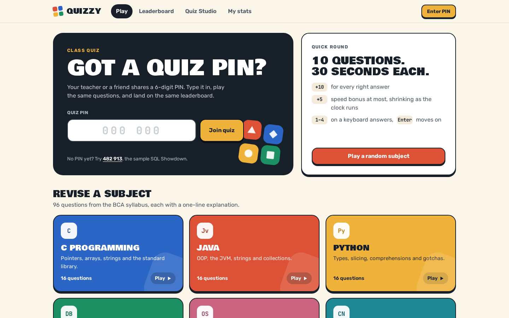
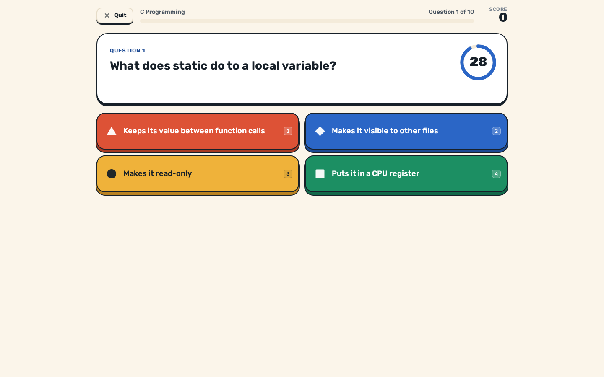
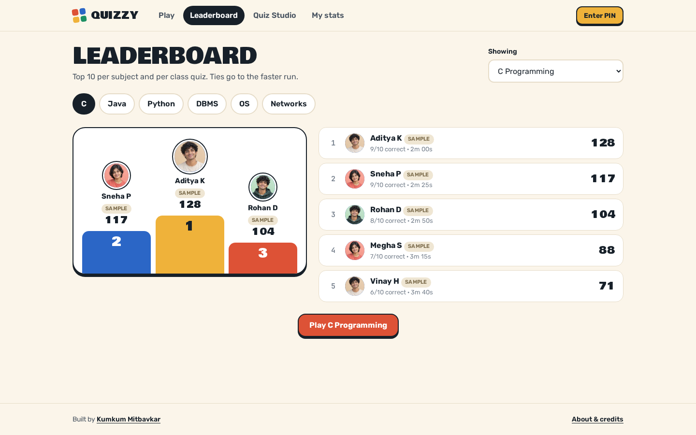
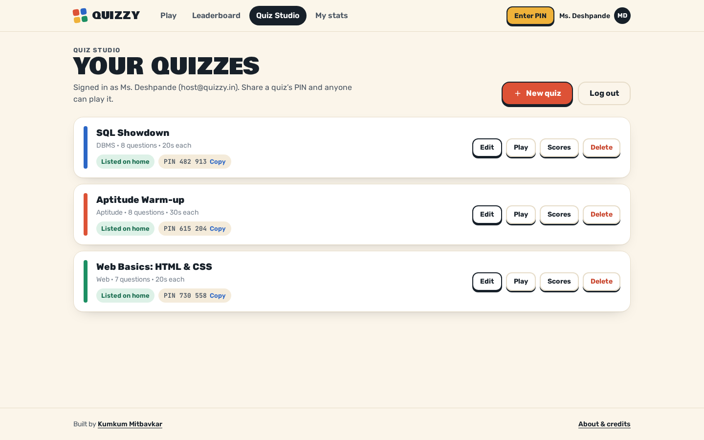

# Quizzy

Quiz rounds for BCA revision, plus class quizzes that anyone can make and share with a 6-digit PIN.

**Live demo:** https://kumkum-mitbavkar-quizzy.vercel.app

## Project Overview

Quizzy is a browser quiz app with two parts. The first is a set of subject rounds for BCA revision: six subjects (C, Java, Python, DBMS, Operating Systems and Computer Networks) with 96 questions in total, each with a one-line explanation. A round is 10 random questions with the answer options shuffled every time, a 30-second countdown per question, and a score that rewards speed.

The second part is class quizzes. A logged-in host builds a quiz in Quiz Studio, and the app gives it a 6-digit PIN. Players type the PIN (or open a `#/join?pin=` link) and play the same questions, then land on a shared leaderboard for that quiz. Three sample quizzes ship with the app.

## Problem Statement

Revision for a BCA exam or an aptitude test usually means reading notes or answering questions on paper, with no timer and no way to compare results with classmates. Teachers who want a quick quiz for a class need a tool that takes minutes to set up and needs no installation or account from the students. Quizzy covers both: players need no login to play, and hosts only need an account to create quizzes.

## Key Features

- Six subject rounds drawn from a bundled question bank of 96 questions, each with an explanation shown after the answer.
- 10-question rounds with shuffled options, a countdown ring per question, and scoring of 10 points per correct answer plus a speed bonus of up to 5 points.
- Four answer tiles that differ by colour and shape, and keyboard answering (keys 1–4 or A–D, Enter for the next question).
- Results screen with score, accuracy, time, best streak and a full answer review, plus a share button for WhatsApp and a copy option.
- Leaderboards per subject and per class quiz, top 10 shown, ties broken by the faster run. The player's own entries are highlighted.
- Quiz Studio (requires a host login): create, edit, duplicate, reorder and delete questions, add an optional code snippet, set the right answer, and choose per-quiz settings: time per question (10, 20, 30, 45 or 60 seconds), shuffle, card colour, and whether the quiz is listed on the home page or reachable by PIN only.
- A "My stats" screen for the device: rounds played, accuracy, points, a day streak and best score per subject. This is stored in the browser, not on the server.
- The server checks everything it receives: quiz shape (3–30 questions, 2 or more options each), and score submissions, which must match the number of correct answers and a plausible time.

## Technologies Used

- HTML, CSS and JavaScript (ES modules), with no framework and no build step. A small hash router switches between screens.
- Node.js 22 with Vercel-style serverless functions in `api/` (`@vercel/blob` for storage).
- Scrypt password hashing and HMAC-signed session tokens, both from Node's built-in `node:crypto`.
- Vercel Blob (private store) for persisted JSON documents, using ETag compare-and-swap writes.
- Node's built-in test runner (`node --test`) for the unit tests; Python with Playwright for the optional browser test.

## Project Screenshots


*Home: subject rounds, a quick random round and the class quiz PIN box.*


*A C round: countdown ring, four shaped answer tiles and the score so far.*


*Leaderboard for a subject. Entries marked "Sample" are generated demo players.*


*Quiz Studio, shown after the demo host login, with the sample class quizzes and their PINs.*

## Live Demo and Source Code

**Live demo:** https://kumkum-mitbavkar-quizzy.vercel.app

This repository contains the source code of the live version. Playing a round never needs a login.

Demo host login (shown on the live login page, for Quiz Studio only): `host@quizzy.in` / `demo1234`

## Installation Instructions

- Node.js 22.x (the version named in `package.json` under `engines`).
- npm (ships with Node).
- Optional, for the browser test only: Python 3 with `playwright` installed (`pip install playwright` then `playwright install chromium`).

## Setup and Running Instructions

```bash
npm install
npm run dev          # serves the app and the /api functions at http://localhost:5300
npm test             # unit tests for the round engine, scoring and account rules
python3 tests/e2e.py http://localhost:5300   # optional browser test (needs Playwright)
```

Without any configuration, data is written as JSON files to a `.data/` folder in the project, so the app runs fully offline. To run against a Vercel Blob store, set these environment variables (values are placeholders):

| Variable | Purpose |
| --- | --- |
| `DATA_READ_WRITE_TOKEN` | Read/write token for the private Vercel Blob store that holds quizzes, accounts and leaderboards. If unset, `.data/` is used. |
| `SESSION_SECRET` | Secret used to sign host session tokens. If unset, a development value is used, so set it in any real deployment. |
| `QUIZZY_DATA_DIR` | Optional folder for the local JSON files (defaults to `.data/`). |

The demo host account and the three sample quizzes are created on first use.

## Project Architecture

Static front end, serverless API, JSON documents in a private blob store.

```
quizzy-v2/
├── index.html            app shell
├── css/                  base.css (tokens, frame), components.css, screens.css
├── js/
│   ├── main.js           hash router
│   ├── engine.js         round building and scoring (pure functions, unit tested)
│   ├── questions.js      the subject question bank (96 questions)
│   ├── catalog.js        subject colours and answer shapes
│   ├── store.js          what the device remembers (name, bests, history, login)
│   ├── api.js            calls to the /api functions
│   └── ui/               one module per screen (home, join, lobby, play, results,
│                         board, login, studio, editor, stats, about)
├── api/
│   ├── auth.js           log in, create account, current user
│   ├── quizzes.js        list, find by PIN, create, update, delete (owner only)
│   ├── scores.js         read and submit leaderboard scores
│   └── _lib/             storage, auth, quiz rules, board rules, sample quizzes
├── assets/               favicon and player avatar images
├── tests/                unit tests (node:test), Playwright browser test
└── scripts/dev-server.mjs  local server for the static files and the /api functions
```

The browser runs the subject rounds itself from the bundled question bank. Quiz and leaderboard data go through the `/api` functions, which read and write JSON documents in storage.

## Future Improvements

- Question bank is fixed in the code; there is no admin screen for the built-in subjects.
- Leaderboards keep the top entries per board and have no pagination or per-class view beyond a single quiz.
- The "My stats" data is kept on the device only, so it does not follow a student to another browser.
- The browser test covers the main flows; the unit tests cover the scoring, validation and account rules.

## Author Information

**Kumkum Mitbavkar**, BCA (5th semester), Gogte College of Commerce, Rani Channamma University, Belagavi. Graduating 2027.

- Portfolio: https://kumkummitbavkar.in
- GitHub: https://github.com/kumkum-mitbavkar
